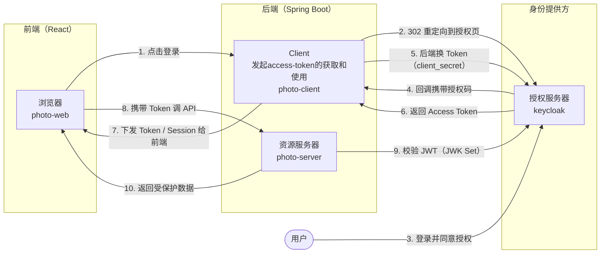

# OAuth2

## 原理

OAuth2 包含 3 个角色：

* 客户端（client）。
* 授权服务器（authorization-server）。例如 keycloak，鉴权、颁发 token
* 资源服务器（resource-server）。提供接口服务，如获取用户下的图片列表，接口即为资源，需对 client 调用时携带的 token 进行校验，通过鉴权后返回数据。

以常见的前后端模式为例，这里引入了 keycloak 作为独立的 SSO 和鉴权服务：



### 客户端（Client）

```yaml
# application.yml (photo-client)
server:
  port: 8081

spring:
  security:
    oauth2:
      client:
        registration:
          photo-print:
            # 与授权服务器中定义的凭证保持一致
            client-id: "photo-client"
            client-secret: "secret"
            authorization-grant-type: "authorization_code"
            scope: "read.photos"
        provider:
          keycloak:
            # 指向授权服务器的 Issuer 地址
            issuer-uri: "http://keycloak:9000"
```

需要确保客户端引入 pom 依赖：

```xml
<dependency>
    <groupId>org.springframework.security</groupId>
    <artifactId>spring-security-oauth2-client</artifactId>
</dependency>
```

### 授权服务器（Authorization Server）

可以使用开源产品如 keycloak 等支持 OAuth2 / OIDC 的产品，也可以使用 spring oauth2 authorization server 实现，示例如下：

```yaml
# application.yml (auth-server)
server:
  port: 9000

spring:
  security:
    oauth2:
      authorizationserver:
        client:
          photo-print-client:
            # 冲印服务的凭证
            client-id: "photo-client"
            client-secret: "{noop}secret"
            # 允许的授权模式：授权码模式（适合有用户参与的流程）
            authorization-grant-types:
              - "authorization_code"
              - "refresh_token"
            # 冲印服务登录后的回调地址
            redirect-uris:
              - "http://localhost:8081/login/oauth2/code/photo-client"
            # 允许申请的权限范围
            scopes:
              - "read.photos"
```

需要确保授权服务器引入 pom 依赖：

```xml
<dependency>
    <groupId>org.springframework.boot</groupId>
    <artifactId>spring-boot-starter-oauth2-authorization-server</artifactId>
</dependency>
```

### 资源服务器（Resource Server）

keycloak 服务可达情况下，只需配置 `issuer-uri`，可自动获取 `jwks_uri` 自动配置 `JwtDecoder` 来验签：

```yaml
spring:
  security:
    oauth2:
      resourceserver:
        jwt:
          issuer-uri: http://keycloak:9000/realms/your-realm
```

需要启用资源服务器：

```java
// SecurityConfig.java (photo-api)
@Configuration
@EnableWebSecurity
public class ResourceServerConfig {

    @Bean
    public SecurityFilterChain filterChain(HttpSecurity http) throws Exception {
        http
            .authorizeHttpRequests(auth -> auth
                .requestMatchers("/api/photos/**").hasAuthority("SCOPE_read.photos")
                .anyRequest().authenticated()
            )
          	// 启用资源服务器
            .oauth2ResourceServer(oauth2 -> oauth2
                .jwt(Customizer.withDefaults()) // 启用 JWT 验证
            );
        return http.build();
    }
}
```

需要确保资源服务器引入 pom 依赖：

```xml
<!-- oauth2-resource-server -->
<!-- JWT encoding/decoding (Nimbus) + bearer token authentication -->
<!-- 包含 spring-security-oauth2-jose -->
<dependency>
    <groupId>org.springframework.boot</groupId>
    <artifactId>spring-boot-starter-oauth2-resource-server</artifactId>
</dependency>
```

## 实践

### 客户端（Client）和资源服务器（Resource Server）

现实中存在情况不会将 Client 和 Resource Server 分开的情况，会把功能同时组织到一个后端服务（spring boot）中：

todo

### 客户端（Client）和授权服务器（Authorization Server）

todo

## 参考链接

开源项目

* [oauth2-authorization-server](https://github.com/musabbozkurt/oauth2-authorization-server)
* [movies-app](https://github.com/naughlan-creator/movies-app)
* [springboot-oauth2-jwt-swagger-ui](https://github.com/hendisantika/springboot-oauth2-jwt-swagger-ui)
* [OAuth2ResourceServer](https://github.com/naveedin2024/OAuth2ResourceServer)
* [OAuth2AuthorizationServer](https://github.com/naveedin2024/OAuth2AuthorizationServer)

文章

* [从零搭建企业 OAuth2 授权中心：Spring Boot 集成 Spring Authorization Server 与](https://mp.weixin.qq.com/s/E2sNYNM8pcc4Kfqjy2enNQ?poc_token=HGcY02qjW7og9q_IgLJdQzMVMCYDIusksrE7VHcH)
* [Spring Security + OAuth2 认证授权（一）：从零搭建认证授权中心](https://mp.weixin.qq.com/s/vGZFXeikg8VXnQb_7AvdxQ)
* [Spring Security + OAuth2 认证授权（二）：JWT 深度解析与令牌增强](https://mp.weixin.qq.com/s/-Ka5ur1am9aG7Rij-Gjqvg)
* [Spring Security + OAuth2 认证授权（三）：授权码模式与第三方登录](https://mp.weixin.qq.com/s/B8btHcs3--ybko2nuUEf1w)
* [Spring Security + OAuth2 认证授权（四）：资源服务与权限控制](https://mp.weixin.qq.com/s/OqF9JyMTymRcmDVVmb88iA)
* [Spring Security + OAuth2 认证授权（五）：客户端管理与生产扩展](https://mp.weixin.qq.com/s/UDIc0wWXxHcf0ICg-qEwbg)
* [Spring Security + OAuth2 认证授权（六）：生产环境最佳实践与踩坑总结](https://mp.weixin.qq.com/s/_qZ0sPBX8XLoGtHTWYUV8w)
* [SpringBoot 集成 OAuth2.0 资源服务器与授权服务器](https://mp.weixin.qq.com/s/yrgw9cXyDAt0jIDGFRY0nw)。差
* [Spring gRPC集成Spring Security OAuth2](https://mp.weixin.qq.com/s/xBgOYdxF9A54z_4d-lCfwg)。
* [SpringBoot 整合 OAuth2.0/OpenID Connect 实现第三方登录](https://mp.weixin.qq.com/s/sAI3DCrrGze7zgbXnU4P8g)。OAuth2 登陆成功后应用自身记录用户信息
* [搞定企业级SSO单点登录：OAuth2、OIDC与SAML真实排障血泪史](https://mp.weixin.qq.com/s/SzyRLWcBimBGsVJ2D9YIZQ)
* [Spring Security 7.0 深度整合：OAuth2 与 JWT 在 Spring Boot 4 中的最佳实践](https://mp.weixin.qq.com/s/RxtOXlNKh3S5mYNPmFgqTA)。非完整整合
* [Spring Security 7 细粒度授权实战：基于属性的访问控制（ABAC）落地指南](https://mp.weixin.qq.com/s/yZRUKCVtP3m3C-wrabj0Ug)
* [Spring Security 7 动态权限：基于 OPA（Open Policy Agent）的策略引擎集成](https://mp.weixin.qq.com/s/IOjUQPlugJVGci_0p9n_KQ)
* [3秒登录！支持QQ、GitHub、Gitee等OAuth2登录，你的系统跟上潮流了吗？（附源码）](https://mp.weixin.qq.com/s/ljXzp81EhcEIhcPvFwfTfQ)
* [SpringBoot3.4.1和Spring Security6.4.2结合OAuth2实现GitHub授权登录](https://mp.weixin.qq.com/s/9_20B2kVehjHiikegw6LRA)
* [Spring Security 7 整合CAS SSO 单点登录：从 CAS Ticket 到 Redis Session](https://mp.weixin.qq.com/s/mDWdaBsCDKagsdepB23YGw)
* [使用 Spring Security 集成 OpenID Connect（OIDC）登录](https://mp.weixin.qq.com/s/4oBm48vvjOL0Mx9LYFlj2Q)
* [基于 Spring Security 实现轻量级单点登录方案](https://mp.weixin.qq.com/s/jk1twt7OoPYoDgXBEFK8Tw)
* [Spring Security 7.0 配置大改，再不升级就晚了！](https://mp.weixin.qq.com/s/0qSNLIYHJgAeLaHwv2PjLg)
